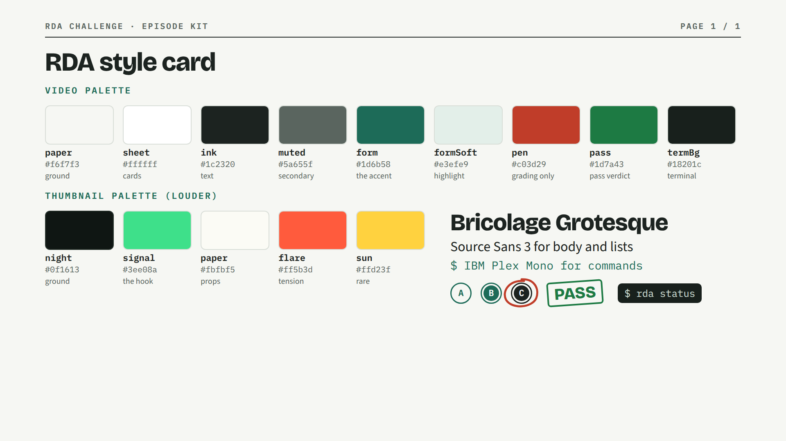

# RDA style bible

**Version 0.5 · 2026-10-18 · a living guide, not a lock.**

This is how RDA videos and thumbnails should look, sound and read, so each episode feels like part of
one series. It is expected to change as the user and the YouTube audience react. When something here
stops working, change it, log why in the [feedback log](#feedback-log), and bump the version. Do not
silently drift: a deliberate change is fine, an accidental one is not.

**Where it lives in code:** `remotion/src/lib/rda.tsx` (the tokens `C`, `T`, `F`, `EASE` and the shared
pieces). Change the code and this file together. The rendered reference is
[`docs/style/rda-style-card.png`](style/rda-style-card.png), made from the live tokens by
`remotion/src/shots/rda-brand/RdaStyleCard.tsx`, so re-render it after any token change.

**Not yet the repo brand contract.** `brand.md`, `remotion/src/brand.ts` and `remotion/src/fonts.ts`
still hold the upstream pipeline's indigo house style. Running `/brand-setup` with this file as input
would make RDA the brand everywhere (see `docs/decisions.md` D8).

---

## 1. The idea in one line

**An exam booklet, graded.** Paper, ruled headers, answer-sheet bubbles, a green that reads as an
official form, and a red pen that only ever marks a grade. Calm and legible like a test paper; the
drama comes from the stakes, not the decoration.

## 2. Color bible

### Video palette (the episode itself)

| Token | Hex | Role | Use it for | Rough share of a frame |
|---|---|---|---|---|
| `paper` | `#f6f7f3` | ground | every full-screen background | most of it |
| `sheet` | `#ffffff` | cards | cards, panels, the score card | large areas |
| `ink` | `#1c2320` | text | headlines, body, filled bubbles | text only |
| `muted` | `#5a655f` | secondary | captions, axis labels, sub-lines | small |
| `rule` | `#d9ded8` | lines | card borders, dividers (decorative only) | hairlines |
| `form` | `#1d6b58` | **the accent** | eyebrows, the active item, arrows, commands, the wordmark | about a tenth |
| `formSoft` | `#e3efe9` | highlight | highlighted ranges, tally bar tracks, chips | small |
| `pen` | `#c03d29` | **grading only** | red-pen circles, underlines on the key word, FAIL | a few marks |
| `pass` | `#1d7a43` | verdict | the PASS stamp only | one moment |
| `termBg` / `termFg` / `termDim` | `#18201c` / `#d7e4dc` / `#8ba096` | terminal | command windows and pills | as needed |
| terminal green | `#5fcf8c` | terminal OK | `[x]`, `OK`, the `next:` line inside terminals | small |

### Thumbnail palette (louder on purpose)

Thumbnails compete at 320 pixels wide in a feed, so they flip to a dark ground and a saturated accent.

| Token | Hex | Role |
|---|---|---|
| `night` | `#0f1613` | ground (a green-black, not pure black) |
| `signal` | `#3ee08a` | the hook: the one thing that must be seen |
| `paper` | `#fbfbf5` | props: answer sheets, cards |
| `flare` | `#ff5b3d` | tension: a question mark, a warning, one word |
| `sun` | `#ffd23f` | rare: a number or badge when signal is already used |

### Measured contrast (WCAG ratio; 4.5 is the text minimum, 3 for large text)

| Pair | Ratio | Verdict |
|---|---|---|
| ink on paper | 14.9 | any text |
| ink on formSoft | 13.6 | any text |
| termFg on termBg | 12.7 | any text |
| form on sheet / on paper | 6.4 / 5.9 | text, including small |
| muted on paper | 5.6 | secondary text |
| pass on sheet | 5.4 | text |
| form on formSoft | 5.4 | text |
| pen on paper | 4.95 | text, just; best as marks |
| rule on paper | 1.27 | **never text**, lines only |
| thumbnail: paper on night | 17.7 | anything |
| thumbnail: sun on night | 12.7 | anything |
| thumbnail: signal on night | 10.7 | the hook |
| thumbnail: flare on night | 6.0 | text |
| thumbnail: flare on paper | 2.97 | **avoid**; marks on paper use `pen` |
| thumbnail: signal on paper | 1.65 | **never** |

### Color rules

1. **One accent per frame.** `form` in video, `signal` in thumbnails. If two things are accented,
   neither is.
2. **Red means a grade.** `pen` (and `flare` in thumbnails) is for marks, FAIL, and tension, never decoration.
3. **Never color alone for pass and fail.** Always say the word (PASS, FAIL) or show a symbol. About
   one man in twelve cannot reliably tell this red from this green.
4. **`form` and `pass` are close greens.** Keep `pass` for the verdict stamp so it keeps its meaning;
   everything else that is green is `form`. If the audience confuses them, separate them (log it).
5. **Sample or illustrative data is labeled** on screen, in `muted` mono caps, above the card it belongs to.

## 3. Typography

| Role | Family (kit name) | Weight | Typical size at 1080p | Notes |
|---|---|---|---|---|
| Headline | Bricolage Grotesque (`F.display`) | 800 | 76 to 104 px, hero 128+ | tracking -0.02em, tight leading 1.05 |
| Eyebrow / label | IBM Plex Mono (`F.mono`) | 600 | 22 to 26 px | ALL CAPS, tracking 0.14em, in `form` |
| Body / list | Source Sans 3 (`F.body`) | 400 to 600 | 38 to 58 px | the reading voice |
| Commands, files, hashes | IBM Plex Mono | 400 to 600 | 26 to 34 px | anything you could type |
| Thumbnail hook | Bricolage Grotesque | 800 | 200+ px at 1280x720 | one or two words |

Fonts are local files in `media/library/fonts/rda/` (OFL), loaded by the kit. On-screen text must be
readable without narration: hold each line at least as long as it takes to read twice.

## 4. Layout

- **Margins:** 110 px left and right at 1920x1080. Content starts below the header strip.
- **The header strip** (`PaperChrome`): `RDA CHALLENGE · EPISODE KIT` left (or the video's own `label`), `PAGE n / N` right, ruled
  in `ink`. The page number is real (the scene index), not decoration.
- **Hierarchy:** eyebrow, headline, then the one visual. Three levels at most.
- **Cards** get a 2 px `rule` border and a 12 to 14 px radius; one card per idea.
- **Talking-head episodes:** concept beats are full-screen cutaways; overlays stay in the top or bottom
  band and never cover the face (pipeline rule from `/make-tsx`).

## 5. Motifs (the series vocabulary)

| Motif | Means | Kit piece |
|---|---|---|
| Answer bubble, filling | a rule, a step, a choice made | `Bubble` |
| Red-pen circle or underline | the key word, the graded answer | SVG path, `pen` |
| Grading stamp | a verdict: PASS, FAIL, FROZEN, MEASURED | `Stamp` |
| Terminal window or pill | the tool doing something real | `Terminal` |
| Hash text, typed out | proof that the exam is frozen | mono, `form` |
| Five-phase bar, to scale | the format itself | from the explainer's S2 |
| Step rail, a row of numbered bubbles filling | where we are in a process (one bubble per step) | `Bubble` row in `script-to-render/ScriptToRender.tsx` |
| Receipt card, label and value rows | numbers measured on the video itself, with the tool that measured each | S7 of `script-to-render` |
| Scene bar, to scale with start frames | a video's own plan | S4 of `script-to-render` |

Use the same motif for the same meaning every time. New motifs get added here before they are reused.

## 6. Motion

- **Entrances:** fade and rise, about 14 frames at 30 fps, 24 px of travel, ease-out (`EASE.out`).
- **Stagger:** 12 to 30 frames between lines that should be read one at a time.
- **Stamps** land in about 9 frames, from 1.6x scale and a slight extra tilt to rest at about -4 degrees.
- **Typing** for commands, at a readable pace (about 2 frames per character).
- **Scene cuts:** an 8-frame fade at each end of a scene. No spins, no elastic bounces.

## 7. Sound

| Moment | Cue (from `media/library/sfx`) | Level (0 to 1) |
|---|---|---|
| A mark, a tick, a checklist line | `ui-click-soft` | 0.2 to 0.4 |
| A card or file appears | `pop-reveal` | 0.24 to 0.3 |
| A verdict stamp | `stamp-hit` | about 0.55 |
| PASS | `chime-reward` right after the stamp | about 0.4 |
| A handoff or scene sweep | `whoosh-soft` | about 0.45 |
| The closing line | `impact-soft` | about 0.4 |
| A scene change | `whoosh-soft` | about 0.35 |
| A command being typed, cut to the typing | `keys-typing-soft` | about 0.4 |
| A still or screenshot appears | `camera-shutter` | about 0.45 |
| A red-pen mark being drawn | `pencil-scribble`, cut to the stroke | about 0.55 |
| A paper sheet or script appears | `page-flip` | about 0.6 |
| A sweep or count building to a number (one per video) | `riser-soft`, cut to the sweep | about 0.3 |

Levels above are for a voiced or bed-led mix. With no voice and quiet music (the 2026-10-18 "how this video was made"
mix 2), effects run at twice these, capped at 1.0, over a bed at 0.3.

- **Music bed:** `docu-pluck` for explainers (curious, light). With no voice, either the bed carries the audio (about
  0.8) or, when the effects should lead and the music sit quietly underneath, about 0.3. Drop it well under the voice
  in talking-head episodes (the pipeline's `mix_music.py` default is -7 dB).
- **Loudness:** exports end at -16 LUFS integrated, -1.5 dBTP, via `tools/master_audio.py`. Exception (D19): a mix of
  effects over quiet music with no voice masters with `--static --lufs -19`, because reaching -16 would mean lifting
  the music back up or crushing the effects.
- **Voice:** the narrator leads. In a text-led video it says the gist of each scene, never every line on screen, and
  starts on the scene's headline (or its first line). Effects run at the table's levels under it, never x2; the bed
  sits about 0.3 between lines and dips to about a third of that under each line (a 6-frame dip, a 12-frame return).
  Measured targets while it speaks: voice about 18 dB (RMS) over the bed and about 10 dB over the effects, with the
  loudest effect moments under the voice's peaks. No effect on the same frame as a line's first word. Free voice
  without a key: Kokoro `af_heart` via `tools/narrate.py` (D20); say in the description that it is synthetic.
- One stamp per verdict. Do not stack risers.

## 7b. News pieces (current-event videos)

From the first news video (`docs/humanoid-2490-video.md`), in `remotion/src/lib/news.tsx`, all on the paper look:

- **Cutouts are paper:** a white edge, a soft two-layer shadow (`CUTOUT_SHADOW`), a tilt of 1 to 3 degrees, torn ends
  on headline strips. Things slap in with a little overshoot (`useSlap`), never bounce around.
- **Receipts:** every number on screen has a `SourceTag` (mono, "SOURCE" in form green, outlet and month). Qualifiers
  stay with the number ("about", "over", "nearly"), set small before it.
- **Diagrams, not borrowed images:** `RobotFigure` and `PersonFigure` are generic drawings, labeled "Diagram" on
  screen; to scale (with a `Ruler`) whenever size is the point.
- **The red pen still grades:** circles on a price, underlines on the words that matter, a strike, a question mark
  between two numbers that disagree, NOT YET. Nothing else is red.
- **Chapters:** a full-frame form-green `ChapterSlide` that slides across, at most one or two per video.
- **Motion that means something:** the diagram waves, falls and gets up when the voice says so; a slow `Drift` keeps
  long layouts alive; no random zooms.

## 8. Thumbnails

**Every video ships with a thumbnail.** No exceptions: episodes, explainers, shorts that get one. A video
is not finished until its thumbnail is made, checked at 320 px, and saved in `videos/<project>/packaging/`.
`rda status` enforces this for episodes.

1. Dark `night` ground, one `signal` hook, props in `paper`. Nothing else competes.
2. **One hook**, one or two words or one number, that **does not repeat the title**.
3. Two or three levels of focus at most: hook, hero object, then (optionally) the host's face.
4. Keep the bottom-right corner clear for YouTube's timestamp.
5. **Honesty:** never show a score, a result, or a prop the video does not deliver.
6. **Check at 320 px wide** before shipping. If the hook does not read there, it is not done.
7. When the face kit and a Gemini key exist, the `/thumbnail` skill can add the host; keep this palette.

Reference: `videos/rda-explainer/packaging/thumb-A.jpg`.

## 9. Words on screen

- **No em dashes or en dashes.** Anywhere. Use a period, a colon or a comma.
- Short sentences. Exact numbers only; nothing estimated is shown as measured.
- Commands and file names exactly as typed, in mono.
- First-timer framing in debriefs on health, legal or safety topics (viewer contract rule 6).

## 10. What to test with the audience

Open questions this guide does not settle yet. Answer them with feedback and retention data, then log it.

- Is the light paper look too quiet next to louder channels, or does it stand out by being calm?
- Does a dark variant of the video palette work better for the debrief (B4) stretch?
- Does `signal` green read as "pass" so strongly that a FAIL episode needs a different thumbnail accent?
- Does a face in the thumbnail beat the graphic-only look for this series?

## Feedback log

Add a row whenever the user, comments, or data change the style. Newest first.

| Date | Source | Observation | Change | Version |
|---|---|---|---|---|
| 2026-10-18 | user | "Carefully consider how to make an actually genuinely engaging video about a current event", then "Give it a shot" | section 7b, news pieces: paper cutouts, source tags on every number, labeled diagrams, red pen for disagreement, chapter slide | 0.5 |
| 2026-10-18 | user | "I want a narrator por favor", then "a free one" | a voice rule in section 7: the narrator leads, effects at table levels, bed dips under each line, measured targets, no effect on a first word; Kokoro via `narrate.py` (D20) | 0.4 |
| 2026-10-18 | user | "Now your task is to add sound and quiet background music to the video" | effects forward (x2) over a 0.3 bed; foley rows added to the sound table (typing, shutter, pencil, page flip, scene whoosh, one riser); -19 LUFS static master for effects-led mixes (D19) | 0.3 |
| 2026-10-18 | session | First non-episode video in the look ("how this video was made") needed a process tracker and a way to show its own numbers | step rail, receipt card and scene bar motifs; MEASURED as a stamp verdict; `PaperChrome` takes a `label` | 0.2 |
| 2026-10-05 | user | Every video must ship with a thumbnail | made a rule in section 8, CLAUDE.md and `rda status` | 0.1 |
| 2026-10-05 | session | First version, distilled from the RDA Episode Kit page, the explainer and thumbnail A | created | 0.1 |

## Changelog

- **0.5 (2026-10-18):** section 7b, news pieces, from the first current-event video (D21).
- **0.4 (2026-10-18):** sound: a voice rule (narrator leads, effects at table levels, the bed dips under each line,
  measured targets), from the narrated mix of the "how this video was made" video (D20).
- **0.3 (2026-10-18):** sound: six foley rows, a quiet-bed level for effects-led mixes with no voice, and the
  -19 LUFS static mastering exception (D19).
- **0.2 (2026-10-18):** three motifs from the script-to-render video (step rail, receipt card, scene bar), MEASURED
  as a stamp verdict, and a configurable header label for videos that are not episodes.
- **0.1 (2026-10-05):** first version. Video and thumbnail palettes with measured contrast, type, layout,
  motifs, motion, sound, thumbnail and copy rules. Kit moved to `remotion/src/lib/rda.tsx` so every
  video shares one source.
